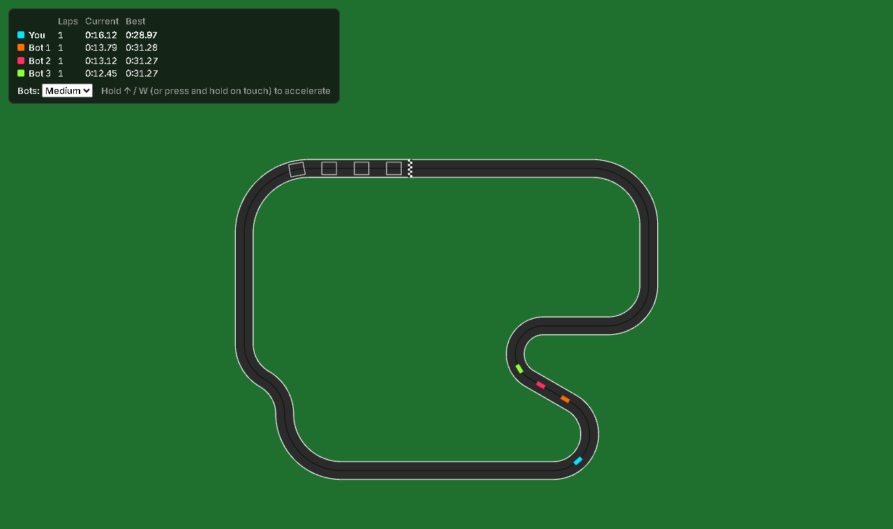

# Slot-Car Racer

A browser-based slot-car racing game. Race three bots around a technical circuit, with a starting grid, countdown lights and lap timing.

**[▶ Play it in your browser](https://dpeck12.github.io/slot-car-racer/)**



## How to play
- Hold **↑** or **W** to accelerate; let go to slow down. On a touch screen, press and hold on the track.
- Take a corner too fast and the car flies out of the slot. It's put back on the track after a two-second delay.
- Accelerate before the lights go out and you get a two-second penalty.
- Use the **Bots** menu to switch between Easy, Medium and Hard.

## How it works
- **Track:** built from straight and curved segments (`public/assets/tracks/*.json`) and sampled into a polyline with headings and edges. Track files must form a closed loop: the turns add up to 360° and the end meets the start.
- **Physics:** fixed 120 Hz timestep with interpolated rendering. Cars accelerate against quadratic drag, and a car de-slots when its sideways acceleration (v²/r) exceeds the grip limit (μg).
- **Bots:** look 15 m ahead for the tightest corner, aim for a share of its maximum safe speed (set by the difficulty level), and control the throttle with a PID controller.
- **Rendering:** [PixiJS](https://pixijs.com/). The camera fits the whole circuit to the window.

## Run it locally
Requires Node.js 18 or later.

```bash
npm install
npm run dev
```

`npm run build` creates a static build in `dist/`. Each push to `main` deploys it to GitHub Pages using the workflow in `.github/workflows/deploy.yml`.

To check that no bot crashes over a few minutes of racing, run:

```bash
npx esbuild scripts/sim.ts --bundle --platform=node --outfile=.sim.cjs && node .sim.cjs Hard 180
```

## Tech
TypeScript · Vite · PixiJS

## Licence
[MIT](LICENSE)
